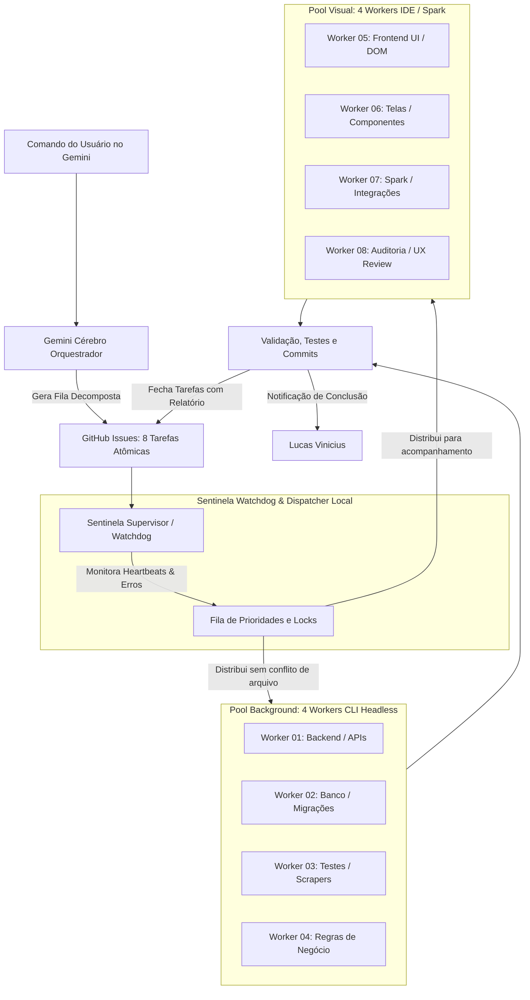

# 🏛️ ARQUITETURA DA MÁQUINA MULTI-AGENTE AUTÔNOMA SENTINELA

**Objetivo:** Transformar 1 comando de alto nível no Gemini em uma esteira de execução massiva com até 8 tarefas concorrentes, supervisão de falhas, auto-recuperação e zero sobrecarga no Mac.

---

## 1. VISÃO GERAL DO FLUXO (DO COMANDO À ENTREGA)



---

## 2. A MÁQUINA FICA PESADA? (ANÁLISE DE CARGA REAL NO MAC)

### Por que NÃO vai pesar:
1. **Processamento em Nuvem:** Os subagentes executam através do motor `gemini-3.8-flash-high` nos servidores da Google. A inferência de IA **não usa sua placa de vídeo nem aquece seu Mac**.
2. **Consumo de Memória:** Cada worker CLI (`agy`) gasta em média **~60 MB de RAM**. Rodar 4 a 8 workers simultâneos gasta menos de **500 MB de RAM no total** (em um Mac com Apple Silicon de 16GB+, isso representa menos de 3% da máquina).
3. **Consumo de CPU:** Os workers só consomem CPU brevemente quando compilam ou executam os testes locais (ex: `pytest`, `npm test`). No restante do tempo, ficam aguardando I/O de rede.

### Onde está o perigo real e como nós blindamos:
* ⚠️ **Perigo 1: Conflito de Arquivos (Race Conditions):** Se 2 agentes tentarem editar o mesmo arquivo ao mesmo tempo, o código se corrompe.
  * 🛡️ **Solução Sentinela:** **Scope Lock Exclusivo**. O Dispatcher só libera uma tarefa para um worker se nenhum dos arquivos dela estiver sendo editado por outro worker ativo.
* ⚠️ **Perigo 2: Limite de Conexões de Rede (Rate Limits):** 8 agentes chamando a API no mesmo milissegundo podem tomar timeout.
  * 🛡️ **Solução Sentinela:** **Fila com Jitter (Delay de 2s)** entre disparos de novos workers.

---

## 3. SEPARAÇÃO DOS AGENTES (4 BACKGROUND + 4 VISUAIS)

Toda tarefa criada pelo Gemini contém nos metadados da Issue o modo de despacho:

```yaml
agent_task:
  version: 5.0
  task_id: "ZENTINEL-042"
  target_project: "Zentinel"
  execution_mode: "BACKGROUND_DAEMON" # ou "VISUAL_IDE"
  assigned_worker: "worker-01"
  locked_files:
    - "apps/api/routers/auth.py"
    - "apps/api/services/jwt.py"
  timeout_seconds: 300
```

### 🔹 Os 4 Workers em Background (Silenciosos / CLI Headless)
* **Perfil:** Backend puro, controllers, banco de dados, regras de negócio, scrapers, websockets e testes unitários.
* **Execução:** Disparados pelo Watcher no terminal invisível via `agy --dangerously-skip-permissions`.
* **Comportamento:** Trabalham sem abrir janelas. Só notificam o macOS se houver erro crítico ou quando a tarefa estiver 100% validada.

### 🔹 Os 4 Workers Visuais (Acompanhados / IDE & Spark)
* **Perfil:** Telas do Next.js, CSS/Glassmorphism, manipulação de DOM, dashboards e integrações de API no Spark.
* **Execução:** Podem rodar aqui na IDE ou no Spark com MCP de navegador (`chrome-devtools`) para testar cliques e verificar o layout.
* **Comportamento:** Mostram diffs na tela e geram prévias visuais para você validar.

---

## 4. O SISTEMA DE RESILIÊNCIA (ANTI-TRAVAMENTO E AUTO-RECUPERAÇÃO)

Você pontuou com precisão cirúrgica: **IA às vezes para, dá erro de conexão ou buga**. Sem um supervisor, uma máquina autônoma engasga. Por isso, a arquitetura inclui 4 travas de sobrevivência:

### ⏱️ 1. Watchdog de Timeout & Heartbeat (Detecção de Travamento)
* Cada worker deve atualizar seu status a cada 30 segundos.
* Se um worker passar **mais de 3 minutos sem alterar arquivos nem emitir saída** (travado em loop):
  1. O Watchdog detecta o estado `STALLED`.
  2. Mata o processo órfão (`kill -9 PID`).
  3. Reverte alterações parciais não commitadas (`git restore .`).
  4. Registra na Issue: `[AVISO] Worker travou. Reiniciando tarefa com retry 1/3`.

### 🔄 2. Tratamento de Erro de Conexão (Exponential Backoff)
* Se a internet oscilar ou a API do Gemini retornar erro temporário (503 / 429 / ECONNRESET):
* O worker entra em pausa por 5 segundos ➔ 15 segundos ➔ 30 segundos.
* Não cancela a tarefa; ele recupera a conexão e continua de onde parou.

### 🧪 3. Trava "Test Before / Test After" com Auto-Rollback
* Antes de mexer, o worker roda os testes (baseline).
* Se a alteração dele quebrar o build ou os testes e ele não conseguir corrigir em 2 tentativas:
* Ele desfaz o diff (`git checkout -- .`) para não deixar código quebrado no seu Mac e marca a tarefa no GitHub como `BLOCKED: REQUIRES_HUMAN_REVIEW`.

---

## 5. PAINEL DE CONTROLE EM TEMPO REAL (`ESTADO_OPERACIONAL.json`)

Para você e o Gemini saberem exatamente o que está acontecendo a qualquer segundo:

```json
{
  "updated_at": "2026-10-12T02:45:00Z",
  "active_workers": {
    "worker_01": {
      "type": "BACKGROUND",
      "project": "Zentinel",
      "task": "Issue #25 - JWT Auth",
      "status": "EXECUTING",
      "progress": "60%",
      "heartbeat": "ONLINE"
    },
    "worker_02": {
      "type": "BACKGROUND",
      "project": "Dados Bacbo",
      "task": "Issue #14 - WebSocket Ping",
      "status": "TESTING",
      "progress": "90%",
      "heartbeat": "ONLINE"
    },
    "worker_05": {
      "type": "VISUAL",
      "project": "Zentinel",
      "task": "Issue #26 - Tela de Login",
      "status": "WAITING_REVIEW",
      "progress": "100%",
      "heartbeat": "DONE"
    }
  },
  "queue_pending": 5,
  "completed_today": 12
}
```

O Gemini lê esse JSON pelo MCP ou pela pasta conectada e te dá o relatório falado: *"Lucas, o Worker 1 está terminando o JWT e o Worker 5 já deixou a tela pronta para você ver!"*.
